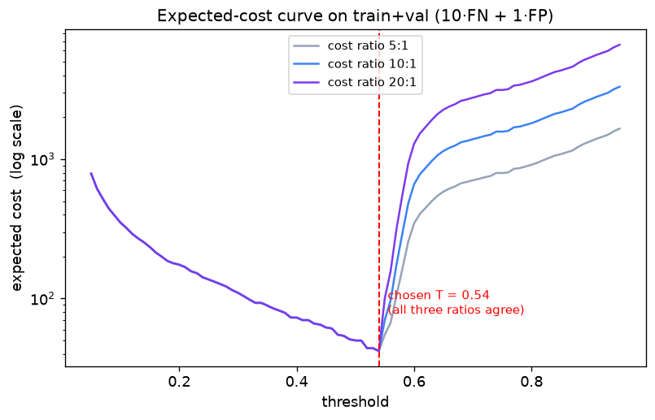
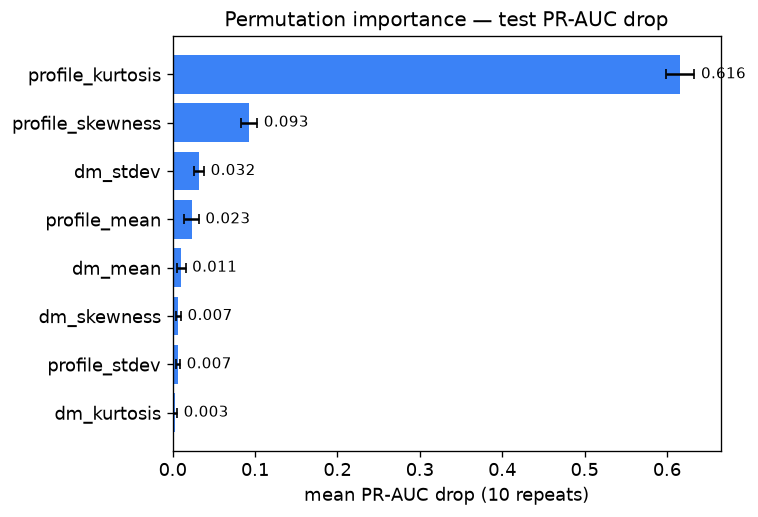
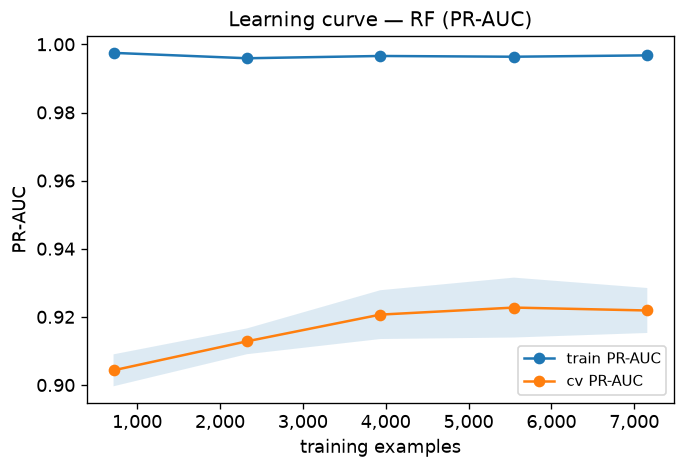
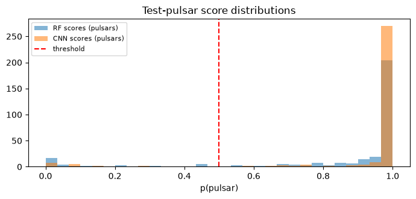
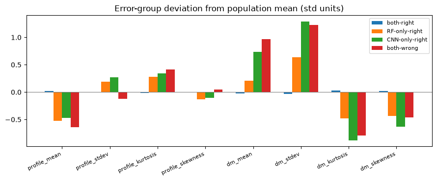

# Calibrated, cost-sensitive pulsar candidate selection on HTRU2: a classical machine learning study

**Project 7, Section A: Astrophysics.** Team: Aditya Shaji, Atharav Gavankar. Second Year B.Tech CSE (AI & ML). Guide: Prof. Dr. Rabinder Henry. Report version 2.0.

> **Status.** Every number in this report is measured in the accompanying notebooks on fixed `SEED = 42` stratified splits, or is quoted from a cited paper and marked as such. The machine-readable source of the final test numbers is `results/final_metrics.json`, which is regenerated by running `pulsar_selection.ipynb` (the `results/` folder is gitignored). The data card is `DATA_CARD.md`; the metric justification is `METRIC_JUSTIFICATION.md`; the code is MIT licensed and the data are CC-BY 4.0.

## Abstract

Radio pulsar surveys produce far more candidate signals than experts can inspect, and nearly all of them are interference or noise. We study automated candidate selection on the HTRU2 benchmark: 17,898 human-vetted candidates from the High Time Resolution Universe survey (South), of which 9.16% are pulsars. The brief for this project asks for more than a high score. The probabilities must mean what they claim, the operating threshold must come from an explicit statement of what a missed pulsar costs, and the features must be interpreted physically.

We build a leakage-controlled pipeline. A stratified 60/20/20 split is created before any class weighting, and a code-printed audit confirms zero duplicate rows and disjoint index sets. A standardised logistic-regression baseline is compared with a Random Forest whose hyperparameters are chosen by 3-fold stratified CV on average precision. A four-way calibration study (none, sigmoid, isotonic, and cross-fitted sigmoid) is run with repeated stratified CV on train+validation and selects **no calibration**: the raw forest has the lowest cross-validated Brier score (0.01721). A written cost model (a missed pulsar costs 10, a wasted follow-up costs 1) puts the operating threshold at **T = 0.54**, the minimum of the expected-cost curve on train+validation. The test set is evaluated exactly once. The final model achieves **ROC-AUC 0.9777** (95% CI 0.9671–0.9872), **PR-AUC 0.9332** (0.9117–0.9542), **precision 0.9183** (0.8889–0.9461), **recall 0.8567** (0.8201–0.8933), **Brier 0.0166** (0.0135–0.0199), and **ECE 0.0099**. Two of the three brief targets are not met: recall ≥ 0.90 at precision ≥ 0.90, and an improved Brier score after calibration. Permutation importance is dominated by profile kurtosis (PR-AUC drop 0.633; the next feature drops 0.037), which matches the physics of a pulsar's sharply peaked pulse profile. The threshold is not the textbook posterior cut (which would give about 0.09); we report this gap as open.

## 1. Introduction

Pulsars are rapidly rotating neutron stars whose radio beams sweep past the Earth like a lighthouse. Their interiors probe states of matter that cannot be reproduced in laboratories, millisecond pulsars anchor pulsar-timing-array searches for gravitational waves, and pulsar timing gave the first indirect detection of gravitational waves (Lyon et al. 2016). Finding them is a triage problem. A survey records a candidate for each periodic signal it detects, and the overwhelming majority are radio-frequency interference or noise. Historically, experts inspected the candidates by eye, which does not scale to modern survey volumes (Lyon et al. 2016).

Earlier automated approaches include statistical filters and decision trees (Lyon et al. 2016, GH-VFDT), neural networks on survey features (Eatough et al. 2010; Bates et al. 2012), SPINN, which is tuned for maximum recall (Morello et al. 2014), and 1D convolutional networks on HTRU2's feature vectors (UCSD ECE228 Report 6, 2019). Image-based systems consume raw diagnostic plots (MICNN, Lin et al. 2020; the PICS line). HTRU2 ships eight summary statistics per candidate and no plot pixels, so the image-based line is a boundary of this study rather than a baseline.

This project is the classical-machine-learning track of the portfolio's dataset-only Project 7. The brief scopes it differently from the image and time-series projects: a strong ranking score is easy to obtain on this dataset, so the assessed work is what comes after. The brief asks for five things, and this report is organised around them:

1. a documented dataset with a data card, provenance, licence and known biases (`DATA_CARD.md`);
2. a split designed and audited for leakage before any model is trained;
3. a baseline reported alongside the main model, with hyperparameters recorded;
4. calibration of the output probabilities, judged by Brier score and a reliability diagram;
5. an operating threshold derived from an explicit cost model, not the default 0.5, together with an interpretation of the features.

We also report honestly where the brief's targets were not met.

**Research questions.**

- RQ1. Does a Random Forest exceed a logistic-regression baseline on this benchmark, and by how much?
- RQ2. Does post-hoc calibration improve the probabilities, measured by cross-validated Brier score?
- RQ3. Where should the operating threshold sit, given an explicit cost ratio, and how sensitive is that choice to the ratio?
- RQ4. What do the features, and the remaining errors, tell us about the physics of the signal?

## 2. Data

HTRU2 (Lyon 2015; UCI ML Repository id 372; DOI 10.24432/C5DK6R; CC-BY 4.0) contains 17,898 candidates: 1,639 pulsars (9.16%) and 16,259 non-pulsars. The candidates come from the HTRU-South survey at the Parkes Observatory, operated by CSIRO. The raw data were acquired by the HTRU collaboration, and the survey was funded by UK EPSRC grant EP/I028099/1. The full data card is `DATA_CARD.md`. Its release and download record is: UCI release of 13 February 2017, figshare mirror `10.6084/m9.figshare.3080389.v1`, and a cached copy committed to this repository on 2026-09-25.

Each candidate is described by eight continuous features. Four describe the integrated pulse profile (mean, standard deviation, excess kurtosis, and skewness) and four describe the dispersion-measure–signal-to-noise curve (the same four statistics). They were computed with PulsarFeatureLab. The dataset has no missing values and no sky position, flux, or period.

**Class balance.** The positive rate is 9.16%, an imbalance of about 9.9 : 1. A model that always predicts "not a pulsar" scores 90.84% accuracy and finds no pulsars. Accuracy is therefore not used anywhere in this report; the justification is in `METRIC_JUSTIFICATION.md`.

**Feature structure.** The correlation matrix (notebook §5) shows two blocks. The profile statistics are strongly coupled: profile skewness and kurtosis correlate at +0.946, and profile mean and kurtosis at −0.874. The DM statistics are coupled in the same way: DM standard deviation and kurtosis at −0.810, and DM skewness and kurtosis at +0.924. The median absolute correlation of a feature with the target is 0.446. The two blocks match their physical origin: the profile describes the shape of the folded pulse, and the DM curve describes how the signal sweeps across dispersion measure.

**Known biases.** The data card lists eight limitations; the most important for interpretation are as follows. The data come from a single survey and telescope, so the model is not calibrated for other surveys. The labels are expert judgements, and some are uncertain; the vetting protocol is not recorded in this repository. The 9.16% prior describes this candidate set, not the sky. The eight summary statistics discard most of the profile shape, so some real pulsars look like interference in these numbers. The non-pulsar class reflects HTRU-South's interference environment, which the model may learn in place of pulsar physics.

## 3. Metrics and success criteria

Metrics were chosen before modelling and are listed with their justification in `METRIC_JUSTIFICATION.md`. ROC-AUC measures ranking independently of the class prior. PR-AUC is sensitive to the rare class and is the more honest headline under imbalance. Precision and recall at the chosen threshold describe the decision the survey actually makes. Brier score and expected calibration error (ECE) describe the quality of the probabilities. All test metrics carry paired stratified bootstrap 95% confidence intervals (B = 2000, `SEED = 42`).

The success criteria come from the brief and were fixed before the test set was opened:

| Criterion | Target | Result | Status |
|---|---|---|---|
| ROC-AUC | ≥ 0.97 | 0.9777 (CI 0.9671–0.9872) | **Met** |
| Recall at precision ≥ 0.90 | recall ≥ 0.90 | precision 0.9183, recall 0.8567 (CI 0.8201–0.8933) | **Not met** |
| Brier after calibration | improved | ΔBrier = 0.0000; no calibrator selected | **Not met** |

Each target is reported as met or not met, with the measured number. No target was adjusted after the test evaluation.

## 4. Methods

### 4.1 Split and leakage control

We create a single stratified 60/20/20 split with `SEED = 42`, using `train_test_split` with stratification. Train has 10,738 candidates (983 pulsars), validation has 3,580 (328 pulsars), and test has 3,580 (328 pulsars). Positive rates are 0.0915, 0.0916, and 0.0916. The split is created before any class weighting, so no weighting or resampling touches the test distribution.

A leakage audit (notebook §6b) prints its checks. It finds zero exact duplicate rows across the dataset and between each pair of splits. It asserts that the train, validation, and test index sets are pairwise disjoint. It confirms that the scaler is fitted on train only, through a `Pipeline` whose `n_samples_seen_` equals the training size (10,738). It confirms that the calibration fold is disjoint from train and test.

### 4.2 Baseline and main model

The baseline is a `StandardScaler` followed by `LogisticRegression(class_weight="balanced", max_iter=2000)`, trained on train. Its validation diagnostics are ROC-AUC 0.9744, PR-AUC 0.9230, and Brier 0.0331.

The main model is a `RandomForestClassifier(class_weight="balanced_subsample")`. Its hyperparameters are chosen by `GridSearchCV` on train only, using 3-fold stratified CV with average precision as the score. The grid is `n_estimators` ∈ {200, 400}, `max_depth` ∈ {None, 20}, and `min_samples_leaf` ∈ {1, 2}. The selected setting is 400 trees, maximum depth 20, and minimum samples per leaf 2. Its validation diagnostics are ROC-AUC 0.9721, PR-AUC 0.9240, and Brier 0.0169.

The two models are compared on identical splits. The forest is slightly below the baseline on validation ROC-AUC (0.9721 vs 0.9744), slightly above it on PR-AUC (0.9240 vs 0.9230), and much better calibrated by Brier score (0.0169 vs 0.0331). RQ1 therefore has a qualified answer: the forest does not dominate the baseline on ranking, but it is a better probability estimator on this data.

### 4.3 Calibration study

Calibration is selected on train+validation only (n = 14,318, positive rate 0.0916), never on test. Four strategies are compared under repeated stratified CV (5 folds × 2 repeats):

1. **none**: the raw forest probabilities.
2. **sigmoid**: Platt scaling, assessed with 3-fold cross-fitting on each CV validation fold.
3. **isotonic**: isotonic regression, with the same 3-fold cross-fitting.
4. **cross**: 5-fold cross-fitted sigmoid scaling, a more conservative calibrator.

Cross-fitting means no calibrator is scored on the data it was fitted to. The selection criterion is the lowest mean CV Brier score. The result is in §5.2.

### 4.4 Cost model and threshold

The cost model is written down before the threshold is chosen. A missed pulsar (false negative, FN) costs the follow-up discovery it would have produced. A wasted follow-up (false positive, FP) costs telescope time. We set C_FN = 10 and C_FP = 1, a 10:1 ratio. This is a modelling choice to be defended, not a physical constant.

The expected cost on train+validation is 10·FN + 1·FP, computed on a grid of 91 thresholds from 0.05 to 0.95. The minimiser is **T = 0.54**. At that threshold the selection set has FN = 0 and FP = 42. We also repeat the selection at cost ratios of 5:1 and 20:1 to test sensitivity.

### 4.5 Final evaluation

The final model is the forest refitted on train+validation with the selected hyperparameters, with calibration selected in §4.3 (in this case, none). The threshold T = 0.54 is fixed on train+validation. The test set is evaluated in one cell of the notebook, which writes predictions, metrics, and SHA-256 hashes of the model and metrics files to `results/`. Confidence intervals come from a paired stratified bootstrap (B = 2000, `SEED = 42`). ECE is computed on the test set.

### 4.6 Interpretation

Permutation importance is computed on the validation set only, with 10 repeats and average precision as the score. We use permutation importance rather than the forest's impurity-based importance, which is biased toward high-cardinality continuous features. A learning curve is computed inside the training set, with 3-fold stratified CV at five training sizes. The test set is not used for either analysis.

## 5. Results

### 5.1 Model comparison

The validation diagnostics in §4.2 show that the forest and the baseline are close on ranking and separate on calibration. On test, the baseline reaches ROC-AUC 0.977 and PR-AUC 0.934, and the forest reaches ROC-AUC 0.9777 and PR-AUC 0.9332. We did not compute bootstrap intervals for the baseline on the test set, so we do not claim a significant ranking difference between the two models on this split.

### 5.2 Calibration: no calibrator was selected

| Method | Mean CV Brier (lower is better) | Mean CV ROC-AUC |
|---|---:|---:|
| **none** | **0.01721 ± 0.00214** | **0.97422** |
| sigmoid | 0.01721 ± 0.00235 | 0.97000 |
| isotonic | 0.01733 ± 0.00248 | 0.96885 |
| cross (5-fold) | 0.01723 ± 0.00236 | 0.96959 |


Raw probabilities win on Brier score, and they also win on ranking. Isotonic regression is the worst on both: its piecewise-constant mapping collapses many raw scores onto a few values, which costs ranking quality. The differences in Brier score between methods are smaller than the CV standard deviation, so the honest conclusion is that no calibrator improves on the raw forest, not that one is significantly worse. The final model is therefore the uncalibrated forest.

The brief expected calibration to improve the Brier score. That criterion is not met. We report the measured reason: a forest trained with `balanced_subsample` weighting is already close to calibrated on this problem. The test ECE of 0.0099 supports this, and a calibrator fitted on about 14,000 samples adds variance without removing bias.

The reliability diagram (Figure 1, left) has few populated bins because almost every score lies near 0 or 0.9. This is a property of the forest's probability distribution. It is why the Brier comparison, rather than the diagram, carries the calibration argument.

### 5.3 Threshold selection



The expected-cost curve (Figure 2) falls steeply from low thresholds and reaches its minimum at T = 0.54. The minimum is at FN = 0 and FP = 42 on the selection set. Above 0.54 the cost rises as false positives accumulate, and the curve climbs steeply on the log scale.

The sensitivity analysis at 5:1, 10:1, and 20:1 selects T = 0.54 in all three cases. This is because at that threshold the selection set has zero false negatives, so cost is driven only by false positives. The result shows the operating point is robust across that bracket. It does not show the operating point is robust to much wider changes in the cost ratio; we did not test those (§7).

On the untouched test set at T = 0.54, the confusion matrix is TN 3,227, FP 25, FN 47, TP 281. Precision is 0.9183 (CI 0.8889–0.9461), recall is 0.8567 (CI 0.8201–0.8933), and F1 is 0.8864.

### 5.4 Final test evaluation

| Metric | Point estimate | 95% CI (B = 2000, paired) |
|---|---:|---|
| ROC-AUC | **0.9777** | 0.9671 – 0.9872 |
| PR-AUC | **0.9332** | 0.9117 – 0.9542 |
| Precision at T = 0.54 | **0.9183** | 0.8889 – 0.9461 |
| Recall at T = 0.54 | **0.8567** | 0.8201 – 0.8933 |
| Brier (calibrated = raw) | **0.0166** | 0.0135 – 0.0199 |
| ΔBrier (raw − calibrated) | 0.0000 | −0.0000 – 0.0000 |
| ECE | **0.0099** | — |

The ROC-AUC target is met: the point estimate and the entire CI lie above 0.97, and the lower bound is 0.9671. The recall target is not met: recall at precision above 0.90 is 0.857, and even the upper bound of its CI (0.893) is below 0.90. The Brier target is not met.

### 5.5 Interpretation: what the model listens to



Permutation importance on the validation set (Figure 3) gives the following PR-AUC drops: `profile_kurtosis` 0.633, `profile_skewness` 0.037, `dm_stdev` 0.020, `profile_mean` 0.016, `dm_mean` 0.008, `dm_skewness` 0.008, `profile_stdev` 0.008, and `dm_kurtosis` 0.006. The profile kurtosis drop is about seventeen times that of the next feature.

The physical reading is as follows. Excess kurtosis of the folded pulse profile measures how sharply the profile peaks. A pulsar is a rotating neutron star whose beam sweeps the telescope once per rotation. Its folded profile is a sharp, repeating peak against a smooth background, so real pulsars sit far out on the kurtosis (and skewness) axis. Interference and noise fold into a flat, near-Gaussian profile. The DM–SNR statistics describe how the signal sweeps across dispersion measure. A genuine astrophysical signal is dispersed in a physically lawful way, which is why the DM block refines the decision (its permutation drops are positive) without carrying the headline. The structure matches real survey pipelines, which detect candidates from the profile and then confirm them with the DM curve.



The learning curve (Figure 4) is computed on 3-fold CV inside the training set, so its largest training size is about 7,159 labels (two-thirds of train). Cross-validated PR-AUC rises from about 0.90 at roughly 700 labels to about 0.92 by about 5,500 labels, and then flattens. Within the range tested, more labels give little gain. The curve does not show whether more labels would help beyond 7,159. Our conclusion is that, in this range, the ceiling looks like the information in the eight features rather than the number of labels. This conclusion answers the brief's question about how many labelled candidates are needed only for the range we tested.

### 5.6 Error analysis

The error analysis (supplementary, `pulsar_selection_v4_errors.ipynb`) uses a 0.5 threshold for comparability with the CNN track, so its counts are not directly comparable to the T = 0.54 confusion matrix above. Its main findings for the forest are these:

- Of the 328 test pulsars, 24 are missed by both the forest and the CNN at 0.5.
- The missed pulsars sit near the population mean on profile kurtosis (about +0.4 standard deviations) rather than in the sharp-peak region where most real pulsars lie.
- Their median score is about 0.1. They are confidently wrong, not near the threshold, so moving the threshold would not recover them.

The worst cases are therefore structural. The fix is new information (for example, raw diagnostic plots), not a different cut-off. This is the clearest example of "what the model has learned to reject": it rejects pulsars whose profiles do not look like the typical pulsar.

## 6. Discussion

**Why "no calibration" is a finding.** The calibration study was designed to test the brief's expectation that calibration improves the Brier score. The measured answer is that, with class-weighted forests on about 14,000 samples, the Platt and isotonic calibrators change the Brier score by less than the CV noise, and isotonic actively harms ranking. We report this as measured. It is not a failure of the study design, since the study tested the expectation directly.

**The threshold gap.** For calibrated probabilities, the cost-optimal threshold under a 10:1 cost ratio is C_FP / (C_FP + C_FN) = 1/11 ≈ 0.09. Our measured minimum is 0.54. We have not explained this gap. The threshold is the empirical minimum of the expected-cost curve on train+validation. We do not claim it is the posterior cut-off; a reader who wants the textbook rule should note that it would lead to many more false alarms than our operating point. The question is open, and we list it in §7.

**Relation to protocol history.** An earlier run of the project (RF trained on train only, Platt fitted on the validation fold) chose T = 0.10 with test precision 0.867 and recall 0.896, and a flat test Brier (0.0167 → 0.0171). That run computed test metrics, so the test set was not untouched at that stage. The numbers are retained for traceability. The final model, calibration choice, and threshold were then chosen on train+validation only. The change moved the threshold from 0.10 to 0.54, raised precision by about five points (0.867 → 0.918), and lowered recall by about four points (0.896 → 0.857). That is a better operating point under the stated 10:1 cost, though not one that dominates the earlier point on every metric.

**Relation to the literature.** Published HTRU2 results are quoted for context, not recomputed. Lyon et al. (2016) report GH-VFDT with accuracy 0.978, precision 0.899, and recall 0.829. The UCSD ECE228 Report 6 (2019) reports a 1D CNN with accuracy 0.9837, positive precision 0.9926, and positive recall 0.9746. Our forest reaches a comparable ranking (ROC-AUC 0.9777). Its distinguishing feature is that the split, the calibration choice, and the threshold are fully specified, and the test set is evaluated once. We could not verify the splits behind the quoted figures, so we do not claim that our numbers are directly comparable to them.

**What would change the picture.** Two things would change the results most. First, more informative inputs: the errors in §5.6 are structural, and the literature points to raw diagnostic plots (the MICNN line), which HTRU2 does not provide. Second, a different cost ratio: the threshold depends on the 10:1 choice, and a much cheaper false alarm would move it lower and buy recall at the price of precision.

## 7. Limitations

- **Unmet targets.** Recall ≥ 0.90 at precision ≥ 0.90 is not met (recall 0.857). Calibration does not improve the Brier score. Both are reported as measured.
- **Threshold gap.** The 0.54 threshold does not match the textbook value of 0.09 for calibrated probabilities. We have not explained the gap.
- **Cost ratio.** The 10:1 ratio is a stated modelling choice. The sensitivity analysis covers only 5:1 to 20:1, and all three ratios select the same threshold for a shared reason (zero false negatives on the selection set). Wider ratios, such as 1:1 or 50:1, were not tested.
- **Learning curve range.** The learning curve is tested only up to about 7,159 labels, two-thirds of the training set. Its conclusion is limited to that range.
- **Single split.** The test metrics come from one stratified split with `SEED = 42`. The confidence intervals capture sampling variation within that split, not variation across splits. Repeated outer splits were not run.
- **No external validation.** The model is trained and tested on one survey. It is not validated on another survey, telescope, or sky region.
- **Summary features.** The eight statistics discard most of the profile shape. Some real pulsars cannot be recovered from them (§5.6).
- **Labels.** The labels are expert judgements. Some are uncertain, and the vetting protocol is not recorded in this repository.
- **Scope of claims.** The model reproduces expert triage on one labelled dataset. It discovers no new pulsars. A model output is a candidate for follow-up, not a detection; confirmation requires follow-up observation.
- **Compute.** The study ran on CPU with fixed seeds. Re-runs are deterministic in the pinned environment (`requirements.txt`).

## 8. Reproducibility and data acknowledgement

**One-command reproduction.** After `pip install -r requirements.txt`, run:

```
python -m jupyter nbconvert --to notebook --execute pulsar_selection.ipynb --output pulsar_selection.executed.ipynb --ExecutePreprocessor.timeout=1800
```

The notebook re-downloads `data/HTRU_2.csv` if it is missing. Figures in `docs/assets/` regenerate with `python docs/plots_all.py` (`SEED = 42`).

**Required acknowledgement.** Raw data acquired by the HTRU collaboration with the Parkes radio telescope, part of the Australia Telescope National Facility, operated by CSIRO; survey funded by UK EPSRC grant EP/I028099/1. Citations: Lyon, R. (2015), *HTRU2* [Dataset], UCI ML Repository, https://doi.org/10.24432/C5DK6R; and Lyon et al., MNRAS 459(1), 2016.

## 9. Conclusion

We built a leakage-controlled classical pipeline for pulsar candidate selection on HTRU2. Its components are a stratified split with a code-printed audit, a logistic-regression baseline, a Random Forest tuned by CV, a four-way calibration study, a written cost model, and a single final test evaluation with bootstrap intervals and ECE. On the untouched test set the forest achieves ROC-AUC 0.9777 and PR-AUC 0.9332, meeting the ranking target. It does not meet the recall-at-precision target (recall 0.857 at precision 0.918), and calibration did not improve the Brier score; the measured reason is that the raw forest is already close to calibrated on this data.

The most useful finding for a survey is in the interpretation. Profile kurtosis, which measures how sharply the pulse profile peaks, carries most of the signal. The errors that remain are pulsars whose profiles do not look sharp, and no threshold change recovers them. The threshold itself is set by a stated cost ratio and is consistent across a 5:1 to 20:1 range. Its disagreement with the textbook rule is open and stated as such.

## References

- Bates, S. D. et al. (2012). MNRAS 427.
- Eatough, R. P. et al. (2010). MNRAS 407.
- Keith, M. J. et al. (2010). "The High Time Resolution Universe Pulsar Survey — I." MNRAS 409.
- Lin, H.-W. et al. (2020). MICNN. arXiv:2007.14843.
- Lyon, R. (2015). *HTRU2* [Dataset]. UCI Machine Learning Repository. https://doi.org/10.24432/C5DK6R.
- Lyon, R. J. et al. (2016). "Fifty Years of Pulsar Candidate Selection: From Simple Filters to Modern Machine Learning." MNRAS 459(1).
- Lyon, R. J. (2015). PhD thesis, University of Manchester (feature definitions).
- Morello, V. et al. (2014). SPINN. MNRAS 443.
- UCSD ECE228 Report 6 (2019). 1D CNN on HTRU2 feature vectors.

---

## Appendix A: Supplementary tracks

The repository retains four supplementary studies. Each uses the same `SEED = 42` splits. They support the main line of this report and do not replace it.

**A.1 1D-CNN replication (v2).** A 32-configuration grid over the published search space selected one block, 16 channels, kernel size 2, no pooling, and ReLU, using validation PR-AUC. On identical splits, the CNN reaches ROC-AUC 0.982 and PR-AUC 0.938, against 0.976 and 0.933 for the retrained forest. The ranking lead is not significant: paired bootstrap CIs include zero. At the 0.5 threshold the forest decides significantly better (McNemar exact p = 0.0001; forest-only-correct 56, CNN-only-correct 21). The summary is: the CNN ranks marginally better, and the forest decides significantly better.

**A.2 Temperature scaling (v3).** A temperature of T = 0.718, fitted on validation NLL, reduces the CNN's Brier score from 0.0284 to 0.0258. This halves the gap to the forest (0.0167) without closing it.

**A.3 Error analysis (v4).** Of the CNN and forest discordant cases at 0.5, all 56 cases where only the forest is correct are CNN false alarms, and all 21 cases where only the CNN is correct are pulsars the forest missed. The 24 pulsars missed by both are feature-atypical, with median scores near 0.1 (§5.6). Figure A1 shows the score distributions of the test pulsars for both models, and Figure A2 shows how each correctness group deviates from the population mean on each feature.





**A.4 Feature ablation (CNN).** With the same protocol, the profile-only CNN reaches ROC-AUC 0.977 and PR-AUC 0.925. The DM-only CNN reaches 0.896 and 0.373. The full eight-feature CNN reaches 0.982 and 0.938. The profile carries the signal, and the DM statistics refine it (`cnn_ablation.py` → `cnn_ablation.json`).

**A.5 Ground-up NumPy rebuild.** Logistic regression, a decision tree, a random forest, an MLP, and a 1D CNN are reimplemented in NumPy (about 350 lines, no library code inside the models). They are verified against their library counterparts: weight cosine similarity 0.999997 for logistic regression, 99.16% decision agreement for the tree, gradient checks of 2.5e-08 for the MLP and 6.6e-10 for the CNN, and metrics within about 0.002 of the library versions.

## Appendix B: Reproducibility checklist

- `SEED = 42` fixed throughout; `train_test_split` is stratified and applied before any weighting.
- Environment pinned in `requirements.txt`: scikit-learn 1.9.1, pandas 3.0.6, numpy 2.5.2, matplotlib 3.11.2, seaborn 0.13.2, joblib 1.5.0, pyarrow 26.0.1; torch 2.14.1 CPU for the CNN track.
- Final artifacts written by the notebook: `results/test_predictions.parquet`, `results/final_metrics.json`, `results/rf_best.joblib`, `results/rf_calibrated.joblib`. SHA-256 hashes are recorded in the executed notebook. The `results/` folder is gitignored and is regenerated by running the notebook.
- Data release, download date, and acknowledgement are recorded in `DATA_CARD.md` and the README.
- Figures regenerate with `python docs/plots_all.py`.
